# Osaka Master Itinerary & Travel Guide (Oct 17 – 21, 2026)
*Action-packed, high-energy itinerary optimized with verified Google Maps routes, 100% train/subway navigation, private airport door-to-door transfers, attraction photos, and full-day entertainment.*

---

## ✈️ Flights & Accommodation

### Flights (Jetstar Japan)
* **Outbound: GK 82**
  * **Departure:** Saturday, Oct 17 @ **2:50 AM** (Manila / MNL Terminal 3)
  * **Arrival:** Saturday, Oct 17 @ **8:05 AM** (Osaka / KIX Terminal 1)
  * *Airport Timing:* Be at NAIA Terminal 3 by **11:30 PM – 11:45 PM** on Friday night (Oct 16).
* **Return: GK 81**
  * **Departure:** Wednesday, Oct 21 @ **10:25 PM** (Osaka / KIX Terminal 1)
  * **Arrival:** Thursday, Oct 22 @ **~1:50 AM** (Manila / MNL Terminal 3)
  * *Airport Timing:* Private pickup at hotel at **07:00 PM**; arrive at KIX by **07:45 PM – 08:00 PM** on Wednesday (Oct 21).

### Hotel: Eslead Hotel Namba South 1 (エスリードホテル難波サウスⅠ)
* **Address:** 3 Chome-11-25 Ebisunishi, Naniwa Ward, Osaka (556-0003)
* **Check-in:** 3:00 PM | **Check-out:** 10:00 AM / 11:00 AM
* **Key Transit Hubs (Google Maps Distances from Hotel):**
  * **Shin-Imamiya Station (JR & Nankai Lines):** 400m / ~5 min flat walk west.
  * **Dobutsuen-mae Station (Osaka Metro Midosuji & Sakaisuji Lines):** 450m / ~5 min flat walk east.
  * **Ebisucho Station (Osaka Metro Sakaisuji Line):** 350m / ~4 min flat walk northeast (southern entrance of Den Den Town).

---

## 🗺️ Master Day-by-Day Action Itinerary

### Day 1: Saturday, Oct 17 — Full Throttle Arrival, Shopping & Neon Nightlife
*Pacing: High energy! Fast bag drop, retro tower climb, fluffy pancakes, river cruise, and giant neon Ferris wheel.*

* **08:05 AM – 10:15 AM | Arrival & Private Airport Pickup**
  * Land at KIX Terminal 1 (08:05 AM). Clear immigration, baggage claim, and customs (~1–1.5 hrs).
  * Meet your private driver at KIX Arrival Lobby. Direct 45-min expressway drive straight to **Eslead Hotel Namba South 1** to drop luggage.

* **10:45 AM – 12:45 PM | Retro Shinsekai, Tsutenkaku Tower & Kushikatsu**
  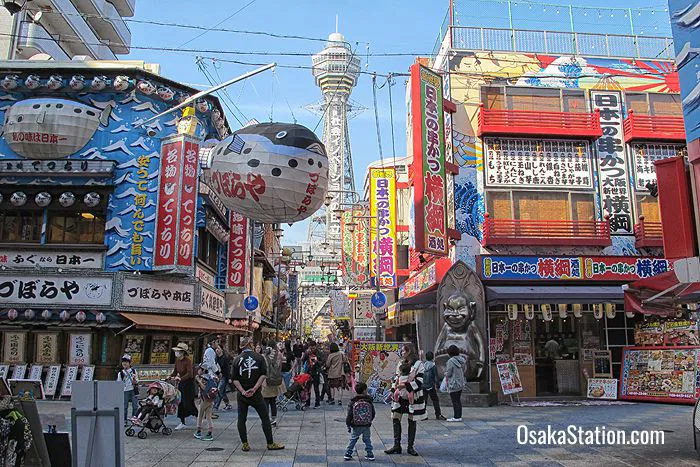
  * Walk 3 mins across the street into **Shinsekai**.
  * Ride the elevator up **Tsutenkaku Tower** for your first 360° panoramic view of Osaka.
  * Pop into **Smartball New Star** (vintage 1950s pinball arcade) and rub the feet of the golden Billiken statue for good luck.
  * **Lunch:** Crisp skewers at **Kushikatsu Daruma** (Shinsekai Sohonten) or piping-hot udon noodle soup.

* **01:00 PM – 02:45 PM | Den Den Town (First Pass) & Pop-Culture Stroll**
  * Stroll north into **Den Den Town** along Sakaisuji Avenue. Browse retro games at *Super Potato* and giant multi-story gachapon capsule toy centers.

* **03:00 PM – 03:45 PM | Quick Hotel Check-in & Freshen Up**
  * Check into Eslead Hotel at 3:00 PM. Drop daypacks, freshen up, and head right back out into the action!

* **04:15 PM – 06:15 PM | Shinsaibashi-Suji Arcade & Fluffy Soufflé Pancakes**
  * Walk 5 mins to Dobutsuen-mae Station $\rightarrow$ Midosuji Line 3 stops (6 mins) to **Shinsaibashi Station**.
  * Walk the famous covered fashion arcade. Stop at **A Happy Pancake** (or *Miki Fruits Cafe*) for famous Japanese jiggly soufflé pancakes and iced matcha.

* **06:30 PM – 08:30 PM | Dotonbori Street Food & Tombori River Cruise**
  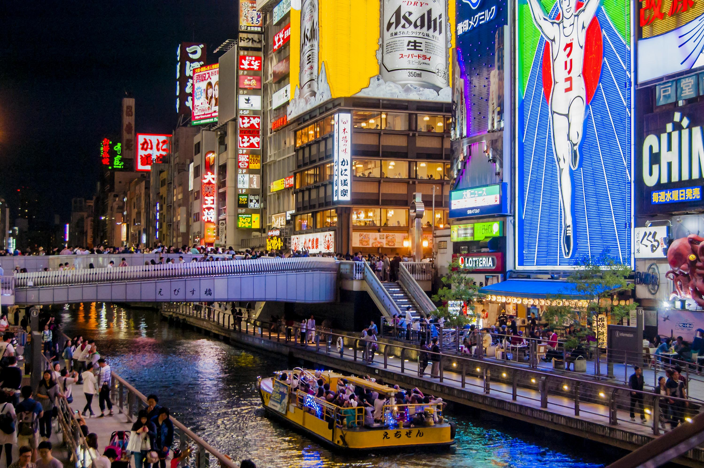
  * Board the **Tombori River Cruise** at dusk right as the neon signs illuminate the canal.
  * **Street Food Dinner:** Fresh octopus takoyaki at *Wanaka*, okonomiyaki at *Chibo*, and gyoza right along the canal.

* **08:30 PM – 09:30 PM | Don Quijote Ferris Wheel (Ebisu Tower)**
  * Ride the yellow oval Ferris wheel built onto the facade of Don Quijote Dotonbori overlooking the canal before taking the Midosuji Line 2 stops back to the hotel.

---

### Day 2: Sunday, Oct 18 — The Grand Osaka Cultural, Castle & Shopping Sweep
*Pacing: Full sightseeing morning, Kuromon street food feast, Lion Head shrine, department store shopping, and Harukas 300 sunset.*

* **09:00 AM – 11:30 AM | Osaka Castle Keep, Moat Boat & Miraiza**
  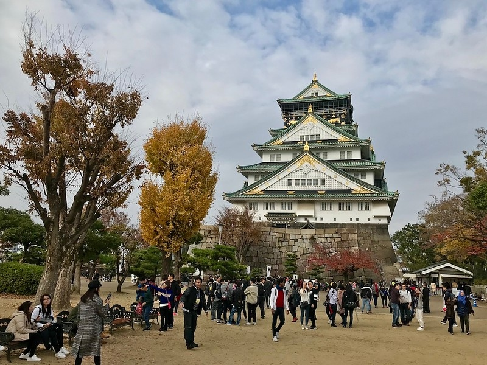
  * Walk 5 mins to Shin-Imamiya $\rightarrow$ **JR Osaka Loop Line** 7 stops (12 mins, direct) to **Morinomiya Station** (North Exit).
  * Board the **Electric Road Train** shuttle through the park straight to the castle courtyard.
  * Take the 20-minute **Golden Gozabune Moat Boat** around the massive stone ramparts.
  * Senior priority elevator to the top castle observation deck.
  * Coffee & matcha soft-serve break inside historic **Miraiza Osaka-jo**.

* **12:00 PM – 01:30 PM | Kuromon Ichiba Market Street Food Feast**
  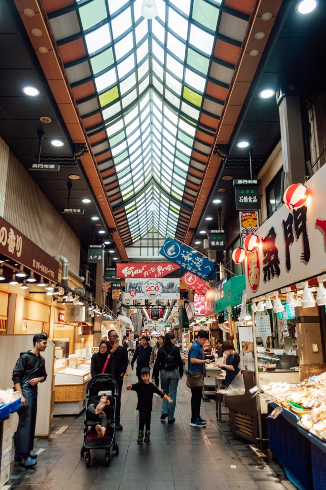
  * Morinomiya Station $\rightarrow$ Chuo Line 2 stops to Sakaisuji-Hommachi $\rightarrow$ Sakaisuji Line 2 stops to **Nipponbashi Station** (Exit 10 elevator straight into market).
  * **Feast:** Grilled wagyu skewers, king crab legs, torched butter scallops, and sweet Japanese strawberries at air-conditioned sit-down stalls.

* **01:45 PM – 02:45 PM | Namba Yasaka Shrine (The Giant Lion Head Shrine)**
  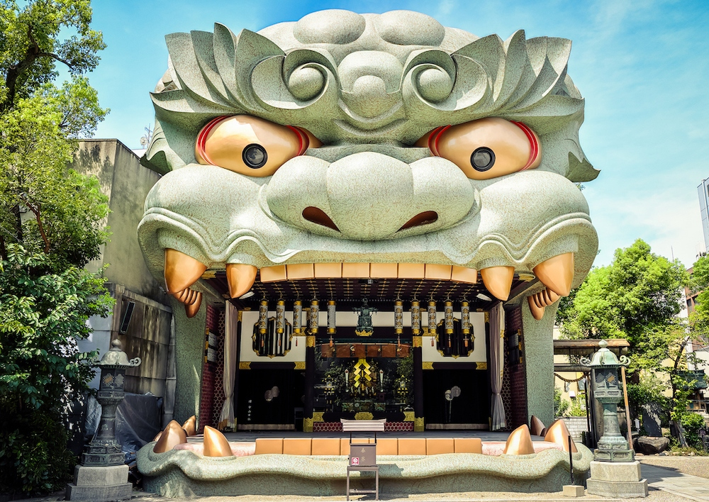
  * Walk 10 mins west through Motomachi directly into **Namba Yasaka Shrine**.
  * Stand in front of the colossal **12-meter lion head stage** for iconic family photos and good fortune charms.

* **03:00 PM – 05:30 PM | Mom’s Department Store Spree & Den Den Town**
  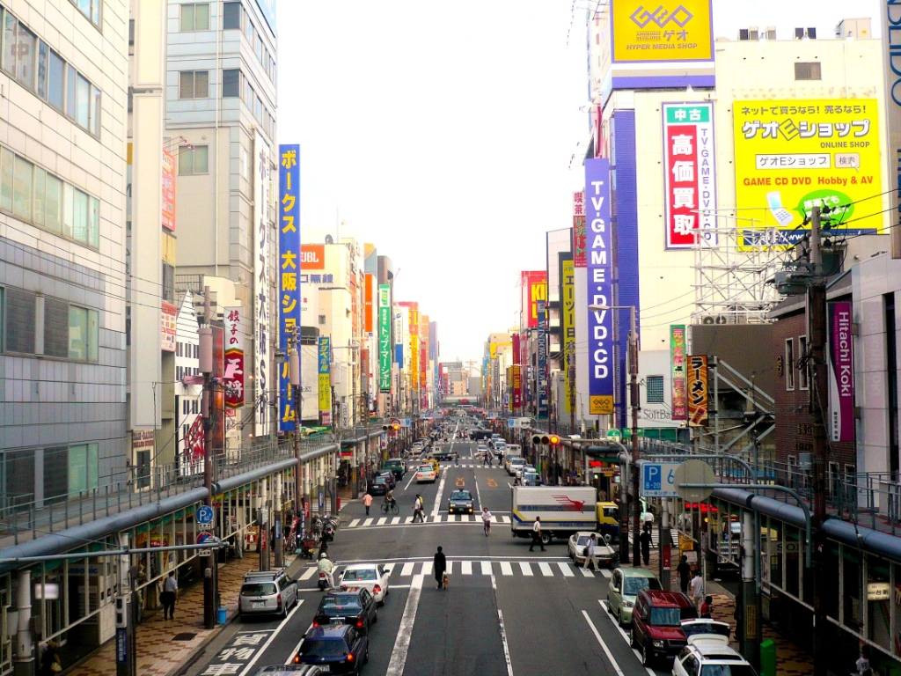
  * **Takashimaya Namba & Daimaru Shinsaibashi:** 8 floors of luxury Japanese skincare, cosmetics, bags, fashion, and open-air rooftop gardens.
  * **Den Den Town (Ota Road):** Explore anime superstores (*Surugaya*, *Mandarake*, *Animate*) and retro game collections.
  * Stroll south down Sakaisuji Avenue straight back toward the hotel area.

* **06:00 PM – 08:30 PM | Sunset at Harukas 300 & Gourmet Sukiyaki Dinner**
  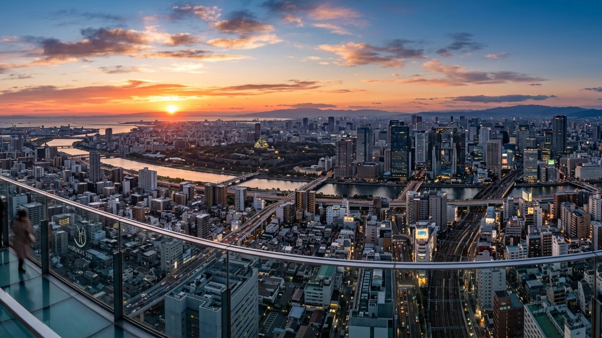
  * Subway Midosuji Line 2 stops (4 mins) to **Tennoji Station** $\rightarrow$ express elevator to 60th-floor **Harukas 300 Observatory** to watch the golden hour sunset over Osaka Bay.
  * **Dinner:** Dine on the 12th–14th restaurant floors of Abeno Harukas (premium Sukiyaki, tonkatsu, or eel).
  * **Return:** JR Yamatoji Line 1 stop (2 mins) back to Shin-Imamiya Station.

* **08:45 PM – 09:30 PM | Hozenji Yokocho Night Walk**
  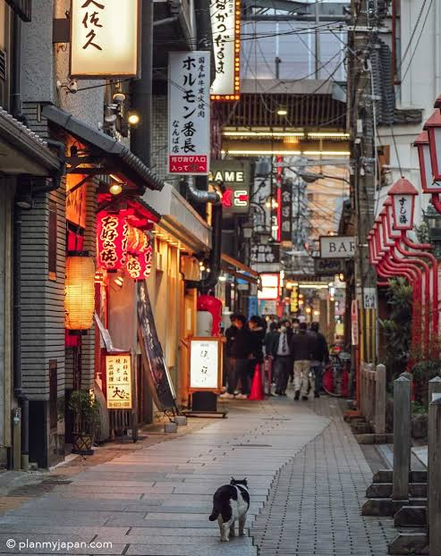
  * Atmospheric stroll through stone-paved **Hozenji Yokocho** with its lantern-lit alleyways, quaint dining spots, and moss-covered Mizukake Fudo-son statue.

---

### Day 3: Monday, Oct 19 — Kyoto & Nara Full-Day Adventure (Confirmed Booking)
*Pacing: Full-day guided coach tour covering four world-famous UNESCO highlights with an included Wagyu Shabu-Shabu lunch!*

* **Tour Details:**
  * **Booking Reference:** `26KK212084684` (Adult x 3)
  * **Lead Traveler:** Maria Lana, Erroba
  * **Included Meal:** Wagyu "Kobe Beef" Shabu-Shabu Lunch (含黑毛和牛「神戶牛」涮涮鍋午餐)
  * **Local Agency Contact:** +81 0484877024

* **Meeting Location & Times (STRICT):**
  * **Pick-up Point:** **VIP Villa Namba** (1-2-1 Nanbanaka, Naniwa-ku)
  * **Meeting Time:** **07:50 AM (JST)** *(Arrive 10 mins early)*
  * **Departure Time:** **08:00 AM (JST) Sharp**
  * **What to look for:** Staff holding the **TABIARUKO** flag.
  * **Train Directions:** Leave hotel at **07:25 AM**. Shin-Imamiya Station $\rightarrow$ JR Yamatoji Line 1 stop (3 mins) to **JR Namba Station** (South Exit) $\rightarrow$ 3-min flat walk (250m) straight to VIP Villa Namba.

* **Tour Highlights:**
  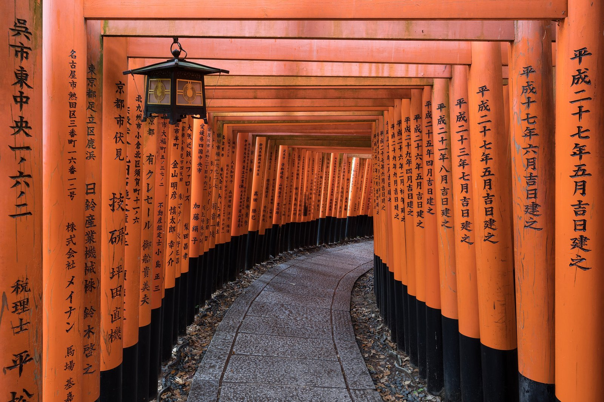
  * **Fushimi Inari Taisha:** Senbon Torii gates. *(Walk the flat paved lower courtyard for photos under the red gates).*

  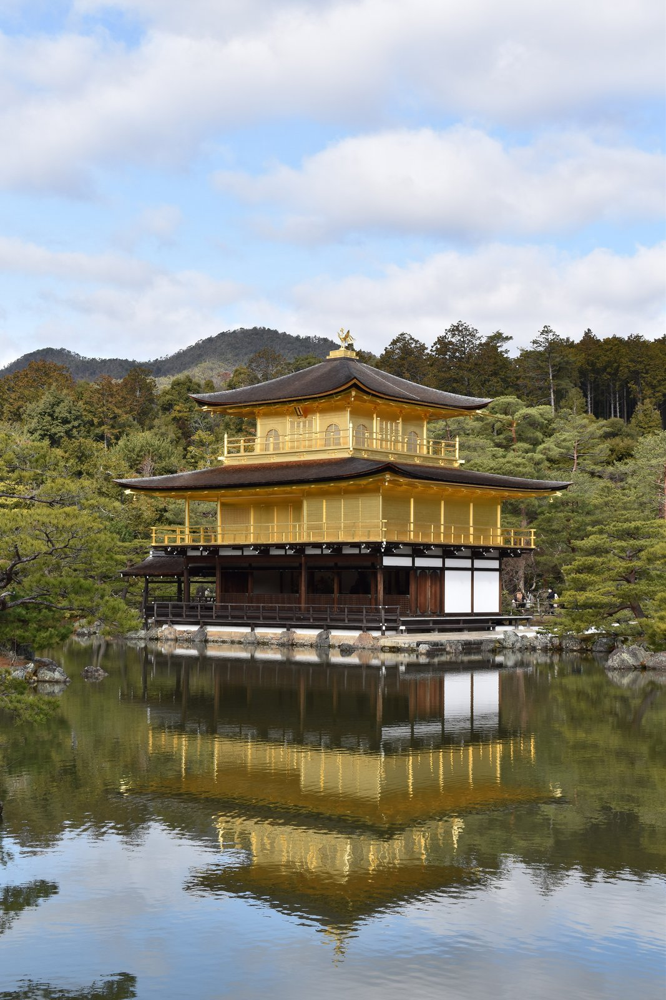
  * **Kinkaku-ji (Golden Pavilion):** Flat paved path around the mirror pond reflecting the gold-leaf Zen temple.
  * **Arashiyama:** Bamboo Grove & historic Togetsukyo Bridge.

  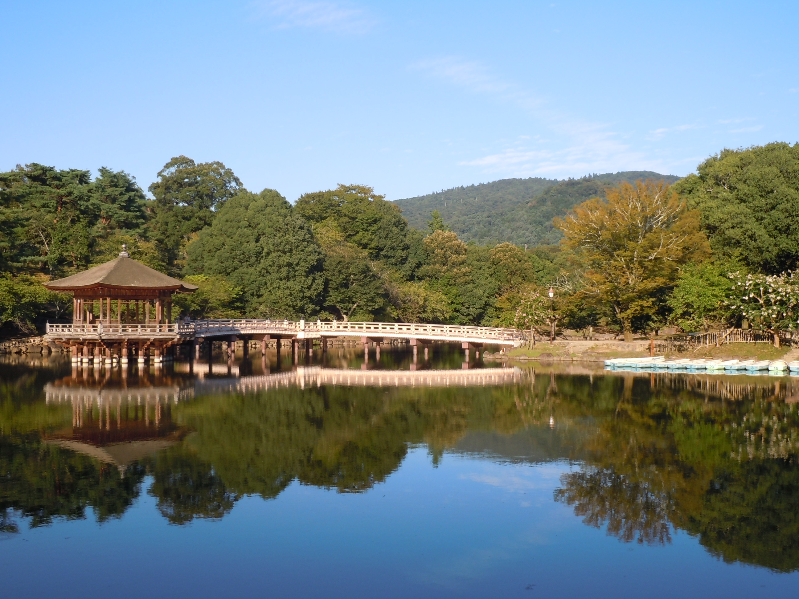
  * **Nara Park:** Famous bowing sika deer & Todai-ji Temple (Giant Bronze Buddha).
  * **Lunch:** Included Wagyu "Kobe Beef" Shabu-Shabu hot pot.

* **07:00 PM – 09:30 PM | Return to Osaka, Dinner & Full Night's Sleep**
  * Tour drops off back at Namba. Enjoy a lively dinner near Namba before taking the Midosuji subway 2 stops (4 mins) back to the hotel.
  * **Full Vacation Mode (100% on Leave):** Enjoy a stress-free evening and a solid, uninterrupted night of sleep so everyone is completely refreshed and ready for Universal Studios Japan in the morning!

---

### Day 4: Tuesday, Oct 20 — Full Day at Universal Studios Japan (USJ)
*Special Mission: Conquering Super Nintendo World without an Express Pass + Full Park Entertainment.*

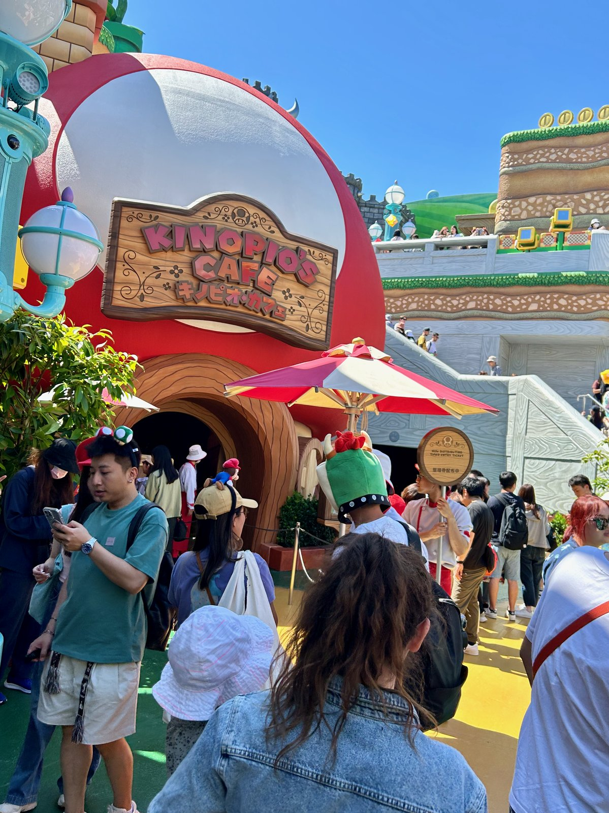

#### 🚆 Train Route to USJ (~20 mins total):
* **06:45 AM:** Walk 5 mins to **Shin-Imamiya Station**.
* **JR Osaka Loop Line** (Platform 1) 5 stops (12 mins) to **Nishikujo Station**.
* Cross platform to **JR Yumesaki Line** 2 stops (5 mins) to **Universal-City Station** $\rightarrow$ walk 200m through CityWalk to the gates by **07:15–07:30 AM**.

---

#### 🍄 Super Nintendo World Strategy & Park Plan:
1. **Rope Drop Walk-in:** Turnstiles routinely open 45–60 mins early (~7:30–7:45 AM). Walk directly into Super Nintendo World during **Free Open Entry** before timed ticketing starts.
2. **Instant App Backup:** Scan in at the gate $\rightarrow$ open USJ App $\rightarrow$ book **Area Timed Entry eTicket** for Super Nintendo World for the whole party.
3. **Nintendo World Action (Morning):**
   * Ride *Mario Kart: Koopa's Challenge*.
   * Play interactive Power-Up Band challenges across the land.
   * Lunch inside **Kinopio's Cafe** (grab a timed ticket at the door).
4. **Midday Magic:**
   * **The Wizarding World of Harry Potter:** Hogsmeade village walk, warm Butterbeer, and Ollivanders wand show.
   * **Minion Park:** Colorful photo-ops and Despicable Me rides.
5. **Afternoon Seated Shows:**
   * **WaterWorld Stunt Show:** Explosive 20-minute seated live-action stunt show.
   * **Sing on Tour:** Air-conditioned, seated Broadway-style musical theater.
6. **Evening Atmosphere & CityWalk Dinner:**
   * Watch the sunset over the USJ lagoon and see the neon lights turn on.
   * Dinner at **Universal CityWalk** (Hard Rock Cafe, Red Lobster, or Takoyaki Park) before boarding the JR train back to Shin-Imamiya.

---

### Day 5: Wednesday, Oct 21 — Bay Cruise, Giant Aquarium, Epic Souvenirs & Flight
*Pacing: Maximum entertainment on travel day! Zero luggage dragging thanks to private evening airport transfer.*

* **10:00 AM – 10:30 AM | Check-out & Bag Drop**
  * Check out of Eslead Hotel. Leave heavy suitcases with hotel reception.

* **10:45 AM – 01:45 PM | Osaka Aquarium Kaiyukan & Santa Maria Harbor Cruise**
  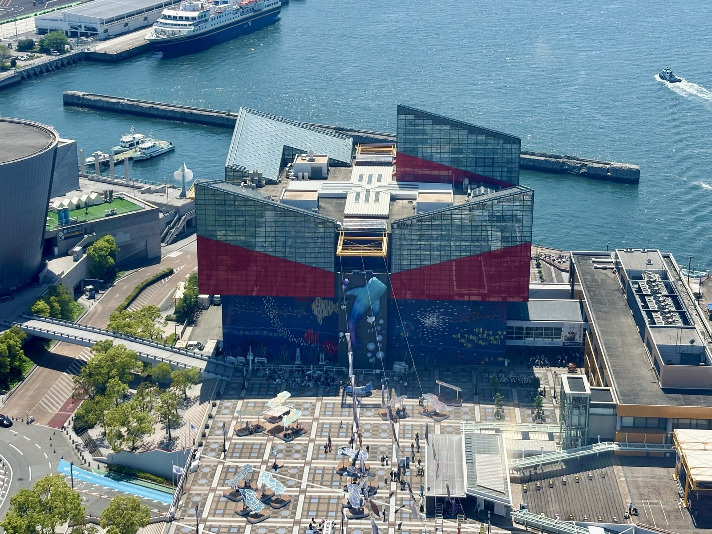
  * **Train Directions (Subway — 18 mins):**
    * Dobutsuen-mae Station $\rightarrow$ Sakaisuji Line 3 stops (5 mins) to Sakaisuji-Hommachi $\rightarrow$ Chuo Line 5 stops (9 mins) to **Osakako Station** (Exit 1/2) $\rightarrow$ walk 400m to the bay.
  * **Kaiyukan Experience (Zero Stairs):** Elevator up to 8th floor $\rightarrow$ gently spiral down the **wide, sloping ramp** viewing giant **whale sharks**, manta rays, and penguins.
  * **Santa Maria Harbor Cruise (45 mins):** Step aboard the Columbus flagship replica for a seated ocean cruise catching sea breezes across Osaka Bay.
  * **Tempozan Giant Ferris Wheel:** Air-conditioned, barrier-free cabin for a seated 15-minute panoramic view of Osaka Port.
  * **Lunch:** Tempozan Marketplace food hall or return to Namba.

* **02:30 PM – 05:30 PM | The Ultimate Souvenir & Depachika Spree**
  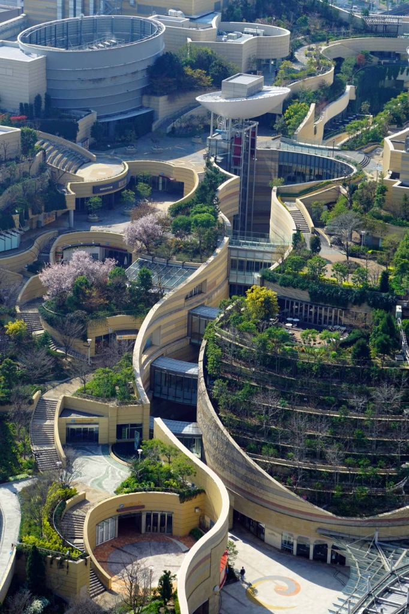
  * Subway Chuo/Midosuji Line directly to **Namba Station**.
  * **Namba Parks:** Stroll the stunning terraced rooftop canyon gardens and enjoy tea and cakes at a terrace cafe.
  * **Takashimaya Depachika (Gourmet Souvenir Haul):**
    * Buy luxury gift boxes: Matcha langue de chat cookies, Baumkuchen cakes, Japanese green teas, wagashi sweets, and packaged ramen to take home.
    * Afternoon tea at **Harbs** for legendary fresh fruit mille-crepe cake.

* **05:45 PM – 06:45 PM | MEGA Don Quijote Shinsekai**
  * Take the Midosuji Line 2 stops back to Dobutsuen-mae.
  * Final tax-free shopping sweep at **MEGA Don Quijote Shinsekai** (near hotel) for Japanese beauty products, snacks, and gadgets.
  * Return to Eslead Hotel to freshen up and collect luggage.

* **07:00 PM | Private Airport Transfer Direct to KIX**
  * Your private transfer driver meets you directly in the lobby of **Eslead Hotel Namba South 1** at **07:00 PM**.
  * Load all luggage and shopping bags into the vehicle.
  * Smooth direct expressway drive (~45 mins) straight to **Kansai Airport (KIX) Terminal 1 Departure Curb** by **07:45–08:00 PM**.
* **08:00 PM:** Check in at KIX Terminal 1 for Jetstar **GK 81** (departing 10:25 PM JST).

---

## 💡 Senior-Friendly Osaka Transit Cheat Sheet

1. **IC Card Tap-and-Go:** Use digital **ICOCA / Suica** on Apple Wallet or physical ICOCA cards for all JR lines and Osaka Metro subways.
2. **Elevator Navigation ("EV"):** Japanese train stations always have barrier-free elevators from platform to concourse and street. Look for the yellow **"EV"** signs.
3. **Station Line Colors & Codes:**
   * 🔴 **Midosuji Line (M):** Red line — connects Dobutsuen-mae, Daikokucho, Namba, Shinsaibashi, Umeda, and Tennoji.
   * 🟤 **Sakaisuji Line (K):** Brown line — connects Dobutsuen-mae, Ebisucho (Den Den Town), and Nipponbashi (Kuromon).
   * 🟢 **Chuo Line (C):** Green line — connects Sakaisuji-Hommachi directly to Osakako (Kaiyukan Aquarium).
   * 🔴 **JR Osaka Loop Line (O):** Circular line connecting Shin-Imamiya, Nishikujo (USJ transfer), Osaka/Umeda, and Morinomiya (Osaka Castle).
